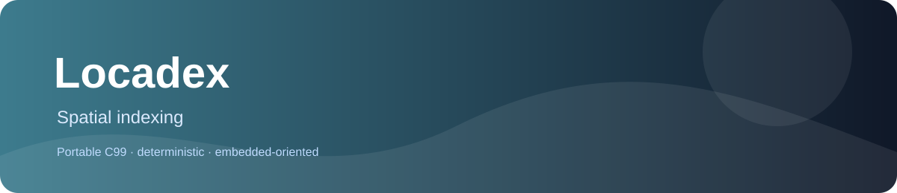

# Locadex

  



Locadex is a portable C99 library for bounded grid, voxel and three-dimensional spatial-index calculations. Its five operations cover compass-direction quantization, 3D Morton encoding/decoding and checked row-major voxel indexing.

## Functional groups

- **Grid direction:** map an integer displacement to the nearest of eight compass sectors.
- **Morton codes:** interleave/deinterleave three 10-bit coordinates.
- **Voxel indexing:** convert between bounded coordinates and a checked linear index.

## Engineering properties

- Deterministic integer operations with explicit fixed-width inputs and outputs.
- No mandatory heap allocation, operating-system service, thread or third-party dependency.
- One C implementation unit per callable operation for selective linking.
- CMake tests and examples are opt-in when consumed as a dependency.

## Quick start

```c
#include <locadex/spatial/morton3_encode_u32.h>
#include <stdint.h>

int main(void)
{
    uint32_t code = 0u;
    if (!locadex_morton3_encode_u32(1u, 2u, 3u, &code)) {
        return 1;
    }
    return code == 53u ? 0 : 1;
}
```

## Build and test

```sh
cmake -S . -B build -DLOCADEX_BUILD_TESTS=ON -DLOCADEX_STRICT_WARNINGS=ON -DCMAKE_BUILD_TYPE=Release
cmake --build build --parallel
ctest --test-dir build --output-on-failure -C Release
```

## Integration

Installed package:

```cmake
find_package(Locadex CONFIG REQUIRED)
target_link_libraries(firmware PRIVATE Locadex::Locadex)
```

`add_subdirectory()` is also supported. For direct source integration, include the desired header under `<locadex/spatial/>` and compile its matching `src/locadex_<operation>.c` unit.

## Validation

All five APIs have direct enabled host tests. Deterministic differential tests include at least 100,000 cases per API plus boundary and small-domain exhaustive checks. Compiler, sanitizer, hardware and measurement evidence is recorded in [TESTING.md](docs/TESTING.md), [AUDIT.md](docs/AUDIT.md) and [PERFORMANCE.md](docs/PERFORMANCE.md). Historical ESP32-S3 evidence is separated from current-revision verification.

## Documentation

| Need | Read |
|---|---|
| Choose a spatial operation | [Family guide](docs/FAMILY_GUIDE.md) |
| Review each API contract | [API reference](docs/API_REFERENCE.md) |
| Reproduce validation | [Testing](docs/TESTING.md) |
| Review design | [Architecture](docs/ARCHITECTURE.md) |
| Review embedded measurements | [Performance](docs/PERFORMANCE.md) |

## License

Apache License 2.0, copyright Vanderhell. See [LICENSE](LICENSE) and [NOTICE](NOTICE).
